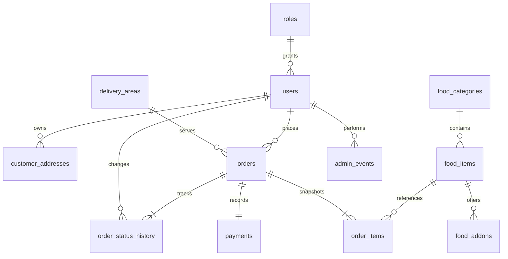

# Smart Cloud Kitchen architecture

Phases 1 and 2 are local development releases, not a production launch. The customer application and admin workspace share one API and database. No Docker or paid APIs are required.

```text
Customer browser + /admin workspace (React, TypeScript, Vite)
  React Router / TanStack Query / React Hook Form + Zod
       | /api (Vite proxy locally; TLS reverse proxy in production)
FastAPI (Pydantic request validation)
  JWT identity -> role dependency -> business rules
       | SQLAlchemy transactions
PostgreSQL 16+
```

The admin application uses its own layout/login at `/admin` and protected `/api/admin` endpoints. Public registration always assigns the customer role. `require_roles` enforces owner/manager access on every admin endpoint, including uploads. Hiding frontend navigation is never an authorization mechanism. Staff provisioning uses an explicit local CLI; no public privilege escalation route exists.

## Folder structure

```text
backend/
  app/
    config.py       environment validation
    db.py           SQLAlchemy sessions
    models.py       relational schema and admin audit ledger
    schemas.py      validated request DTOs
    security.py     Argon2, JWT, role checks
    main.py         customer API and checkout orchestration
    admin.py        protected admin workflow and menu APIs
    admin_schemas.py validated admin request DTOs
    create_owner.py explicit local owner provisioning
    seed.py         idempotent sample catalogue
  alembic/          migration environment and revisions
  tests/           isolated API workflow tests
frontend/
  src/
    components/ui/  shadcn-style Button and Radix Dialog
    lib/            shared styling utility
    api.ts          authenticated HTTP client
    types.ts        API and cart types
    App.tsx         shared layout, authentication and cart state
    pages/          menu, ordering and order history routes
    admin/          separate login, overview, orders and menu workspace
    styles.css      responsive visual system
scripts/            local database helper
docs/               architecture, API and release notes
```

## Current relationships



Money uses PostgreSQL NUMERIC and Python Decimal. Order lines snapshot names, add-ons and prices. The API ignores browser totals and calculates all amounts again. Order, lines, payment and initial status history commit together; failures roll back with the request session. Customer order reads filter by authenticated owner. Admin status/payment changes use row locks, expected-state checks, and audit events in the same transaction. Terminal statuses cannot move backwards.

Business name, contact details, hours, tax, slots and enabled payments live in `business_settings`; seed values are editable database configuration, not checkout constants. Phone and WhatsApp are intentionally blank until the real business contact is known. External Unsplash images are illustrative, not guaranteed photos of the actual dishes.

## Phases and database expansion

1. **Implemented:** setup, relational customer/menu/order schema, auth, homepage, filters, cart, delivery-area pricing, scheduled checkout, customer order reads.
2. **Implemented:** separate admin login/shell, date-filtered overview/charts, food and category editing, photo uploads, availability and archive controls, protected order transitions, COD payment records, table/board views, visual new-order alerts and receipt printing. Granular permissions, staff-management UI, delivery assignments and category images remain follow-up work.
3. KDS, ingredients, recipes, recipe ingredients, stock movements and purchases. Use unique order-consumption ledger keys and row locking for exactly-once stock deduction on acceptance. Snapshot ingredient costs for meaningful historical reporting.
4. Expenses, coupons, customer profiles and saved addresses UI, favourites, reviews, delivery assignments. Add constraints, indexes and auditable state changes in migrations as each workflow is built.
5. Revenue/contribution/net profit reporting, CSV export, production security hardening and deployment validation. The current overview labels delivered-food revenue separately from payment collections; contribution will deduct snapshotted direct costs; net profit will also deduct operating expenses. Do not infer either profit measure from revenue.
6. Forecasting and AI adapters only after the ledger and reporting data are reliable. No AI services run in this release.

Payment and notification providers should be separate adapters with verified, idempotent webhooks and an outbox. This release records COD orders and staff-reported cash collections; it never transfers money or collects online payments. Coupons, stock, notification delivery and account editing remain future work. Admin orders poll every 10 seconds and customer orders every 30 seconds; no delivery progress is simulated.

## Release boundary

Before production: verified mobile/email ownership, password reset, throttled authentication and uploads, secure cookie/refresh-token strategy, payment and webhook integration, checkout idempotency, consistent timezone handling for all API responses, delivery capacity, owner-managed settings and granular permissions, monitoring, backups, and PostgreSQL concurrency/load testing. Current JWTs are held in sessionStorage and expire after 8 hours. Cart data in localStorage contains dish IDs and cooking notes; do not enter sensitive information there. Uploaded menu photos live in `backend/uploads`; back them up and serve them as public assets. Test logs currently include a third-party TestClient deprecation warning, which does not affect passed assertions.
